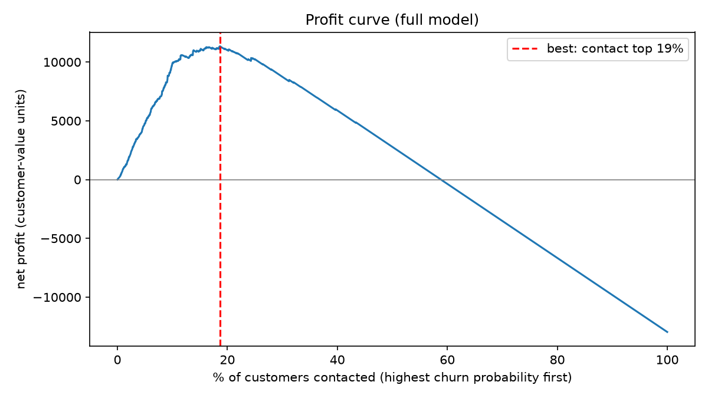

# Telecom Customer Churn: who to contact, and what it is worth

Predicting which telecom customers will cancel within 3 months, and turning those scores into a retention campaign with an estimated net profit.

> **Résumé (FR)** : à partir de 9 mois de comportement client, ce projet prédit les résiliations à 3 mois (gradient boosting, PR-AUC 0,95 en validation croisée imbriquée) puis convertit les scores en décision : contacter ~12 % des clients capte 66 % des départs et reste rentable même sous des hypothèses prudentes. Le projet corrige aussi plusieurs erreurs de mon travail académique initial (voir « What changed »).

## The business problem

An operator wants to send a retention offer before customers leave. Each offer costs money and only works some of the time, so the question is not "how accurate is the model?" but **"which customers should we contact so the campaign pays for itself?"**

Data: [Iranian Churn dataset](https://doi.org/10.24432/C5JW3Z) (UCI), 3,150 customers, 13 variables aggregated over 9 months. The label says whether the customer had left 3 months later. In this sample 15.7% of customers churned (495), so "nobody churns" is already 84.3% accurate: accuracy is not used.

## Key results

All scores come from **nested, stratified, grouped 5-fold cross-validation** (hyperparameters tuned in an inner loop, evaluated on unseen folds).

| Model | ROC-AUC | PR-AUC | Churners found in top 20% |
|---|---|---|---|
| Logistic regression (baseline) | 0.939 | 0.778 | 79% |
| Gradient boosting, tuned (**retained**) | 0.987 | 0.947 | 95% |
| Gradient boosting, tuned, **early-warning** version | 0.978 | 0.906 | 93% |

A random model has a PR-AUC of 0.157. The standard deviation of PR-AUC across folds is about 0.03.

**Two versions of the model.** `complains` and `is_inactive` are very predictive but may be *consequences* of leaving rather than early signals, and the dataset does not say when they were measured. The *early-warning* version drops them and keeps most of the performance.

**From scores to money** (assumptions: offer cost 10, success rate 30%, value saved = `customer_value`; units are those of `customer_value`, which is undocumented):

| Policy | Customers contacted | Churners reached | Net profit |
|---|---|---|---|
| Contact everyone | 100% | 100% | **-12,966** |
| Top 19% by churn probability (k chosen with hindsight) | 19% | 94% | +11,330 |
| **Expected-gain rule** (applicable) | **12%** | **66%** | **+13,054** |
| Expected-gain rule, early-warning model | 13% | 63% | +12,004 |

The rule contacts a customer when `probability x success rate x value - cost > 0`. It beats ranking by probability alone because it also uses the customer's value.



**Robustness.** The campaign stays profitable on the whole assumptions grid (success rate 10-50%, cost 5-20). The worst case (10% success, cost 20) still yields +863 (+532 for the early-warning model), but contacts only 2% of customers.

**Calibration.** Predicted probabilities match observed rates in the high-risk deciles (e.g. 0.49 predicted vs 0.52 observed), which the expected-gain rule relies on. Brier score 0.030 vs 0.132 for a constant prediction.

Narrated analysis: [EDA](notebooks/01_eda.ipynb), [feature analysis](notebooks/02_feature_analysis.ipynb), [model comparison](notebooks/03_model_comparison.ipynb).

## Approach

1. **Data validation** (`data.py`): column names normalised (the raw file has double spaces), expected columns, no missing values, allowed values. Tested.
2. **EDA** (`notebooks/01_eda.ipynb`): one statistical method per variable type (chi-squared and Cramér's V for categorical, Mann-Whitney for numeric, Spearman for correlations).
3. **Features** (`features.py`): deterministic only, so no leakage.
4. **Modelling** (`train.py`, `compare.py`, `tune.py`): pipelines, grouped CV, four models compared, nested CV tuning.
5. **Decision layer** (`evaluate.py`): expected gain, profit curve, sensitivity analysis.
6. **Interpretation** (`explain.py`): calibration, permutation importance, profile of targeted customers.
7. **Deployment** (`final.py`, `predict.py`): final models and a scoring command that outputs the contact list.

## Findings that matter

- **Usage is the strongest signal.** Churners use the service about 3 times less (median 1,182 vs 3,530 seconds). `frequency_of_use` is the top feature in both model versions.
- **Complaints and inactivity are strong but incomplete.** 83% of complainers churn, but only 40% of churners complained; 75% of churners were already inactive. The 125 churners still active are the ones a campaign can realistically save, and the model keeps a PR-AUC of 0.93 (full) and 0.85 (early-warning) on them.
- **`call_failure` and `subscription_length` do not separate churners on their own** (univariate AUC about 0.47) **but matter a lot once usage is controlled**.
- **Churners are only 4.2% of total customer value** (15.7% of customers), so retention offers must be cheap.
- **Contract customers almost never churn** (2.4%), but this is not proof that contracts *cause* loyalty.

## What changed from the academic version

This project reworks a university scoring project (SAS and Python). Issues found and fixed:

- The logistic regression accuracy reported (85.1%) was a code error; the confusion matrix gives 90.0%. Accuracy is now replaced by PR-AUC, recall and lift, which suit an imbalanced target.
- The 300 duplicated rows (9.5%) had gone unnoticed. They are kept but never split between train and test. A sensitivity test shows no leakage effect (PR-AUC gap below 0.003).
- Models were compared on different test sets with no fixed seed. All models now share the same folds.
- `age` is a recoding of `age_group` (5 values), not a real age. `age_group` is not monotonic and `charge_amount` goes to 10, not 9; both are handled accordingly.
- Hyperparameters were not tuned. They are now, with nested CV.

## Limitations

- **Timing of `status` and `complains` is undocumented**, hence the two model versions.
- **Business assumptions are invented** (cost, success rate) and the unit of `customer_value` is unknown. Results show sensitivity, not a forecast.
- **The 15.7% churn rate is a sample rate**, not necessarily the operator's real rate.
- **Associations are not causes.** Recommendations such as improving network quality or pushing contracts need A/B tests.
- **No dates and no customer identifier** in the data: no temporal validation, and customers are identified by row position. Duplicates cannot be told apart.
- Some tuned hyperparameters sit at the edge of the search grid.
- The 125 active churners make active-only metrics noisy.

## Recommendations

1. Use the expected-gain rule to contact about 12% of customers.
2. Prioritise complaint handling, while remembering most churners never complain.
3. Monitor drops in call frequency as an early-warning signal.
4. Investigate call failures with network teams.
5. Test, rather than assume, that contracts reduce churn.

## Run it

Python 3.10+. Download `Customer Churn.csv` from the [UCI page](https://doi.org/10.24432/C5JW3Z) and place it in `data/raw/`.

**Mac / Linux**

```bash
python -m venv .venv && source .venv/bin/activate
make install
make test
make final      # train and save the models
make predict    # contact list in data/processed/
```

**Windows (PowerShell)**

```powershell
python -m venv .venv
.\.venv\Scripts\Activate.ps1
pip install -r requirements.txt
pip install -e .
pytest -q
python -m churn.final
python -m churn.predict
```

Other steps: `python -m churn.train` (baseline), `python -m churn.compare` (models, leakage check, ablation), `python -m churn.tune` (nested CV), `python -m churn.evaluate` (profit), `python -m churn.explain` (calibration, importance). Assumptions are set in `config/config.yaml`.

## Repository layout

```
config/       business assumptions, paths, seed
data/         raw/ (not versioned), processed/ (generated)
notebooks/    01_eda, 02_feature_analysis, 03_model_comparison
tools/        make_notebooks.py (regenerates notebooks 02 and 03)
src/churn/    data, features, train, compare, tune, evaluate, explain, final, predict
tests/        39 pytest tests
models/       saved models (generated, not versioned)
reports/figures/
```

## Author

Essoréké Kiheou, Master MBFA (Assurance), Le Mans Université & Mastet Etude Economiques et Statistiques. [GitHub](https://github.com/essoreke-analyse)


Dataset: Iranian Churn, UCI Machine Learning Repository, https://doi.org/10.24432/C5JW3Z